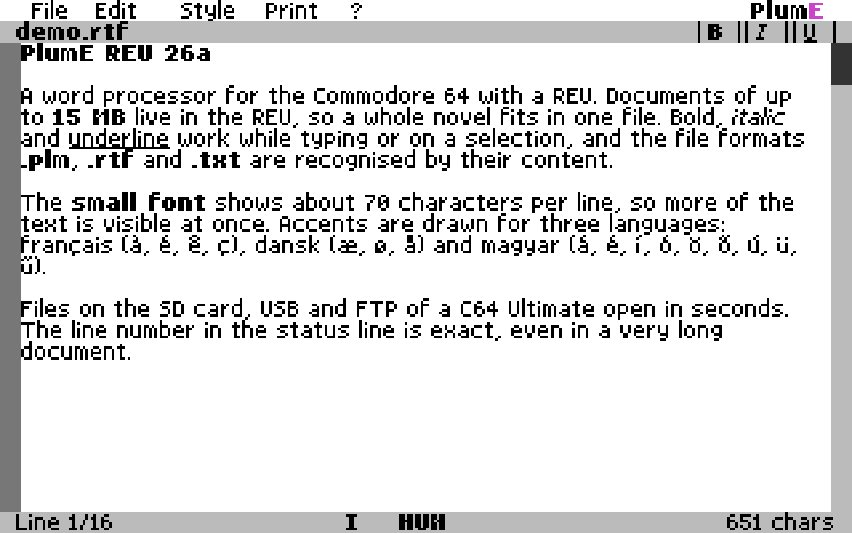
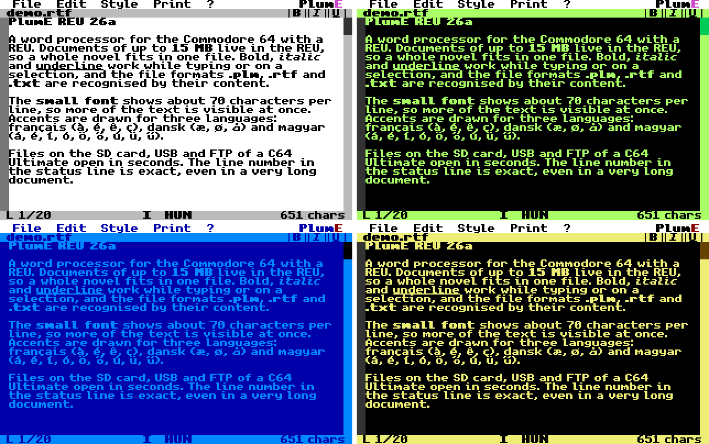
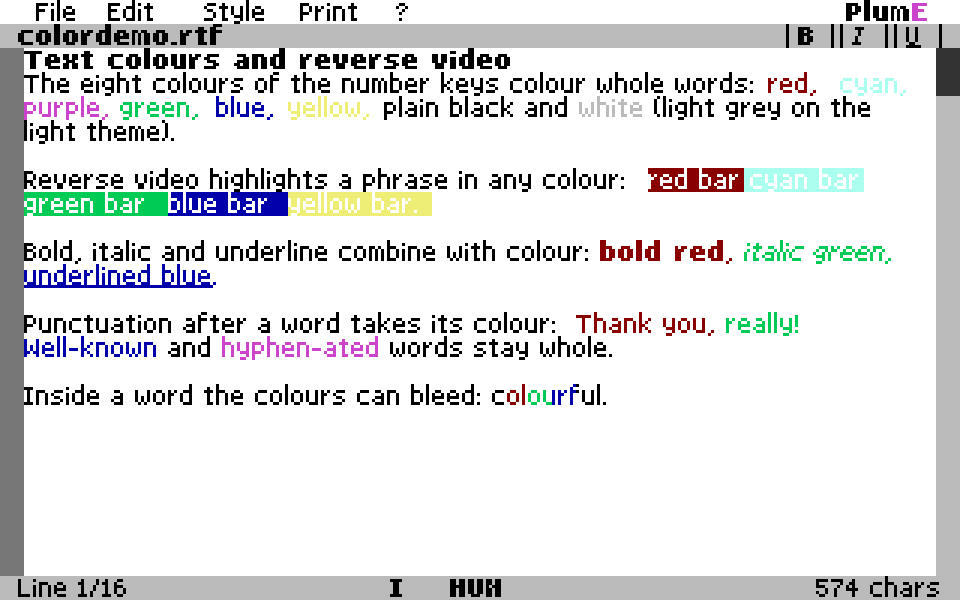
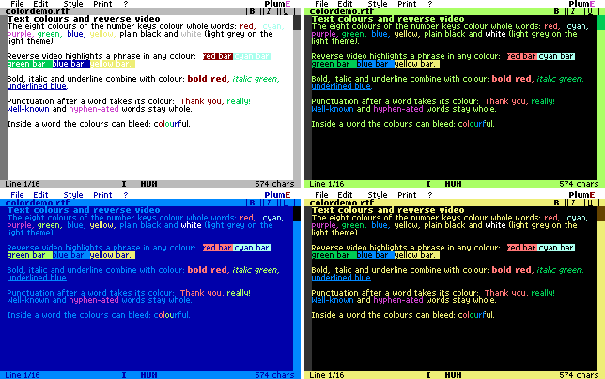
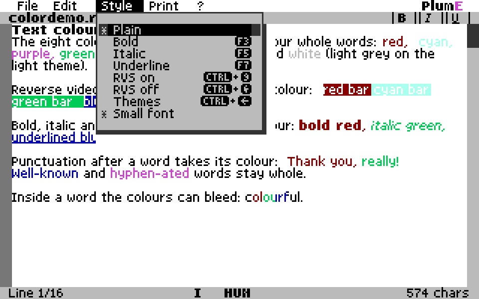
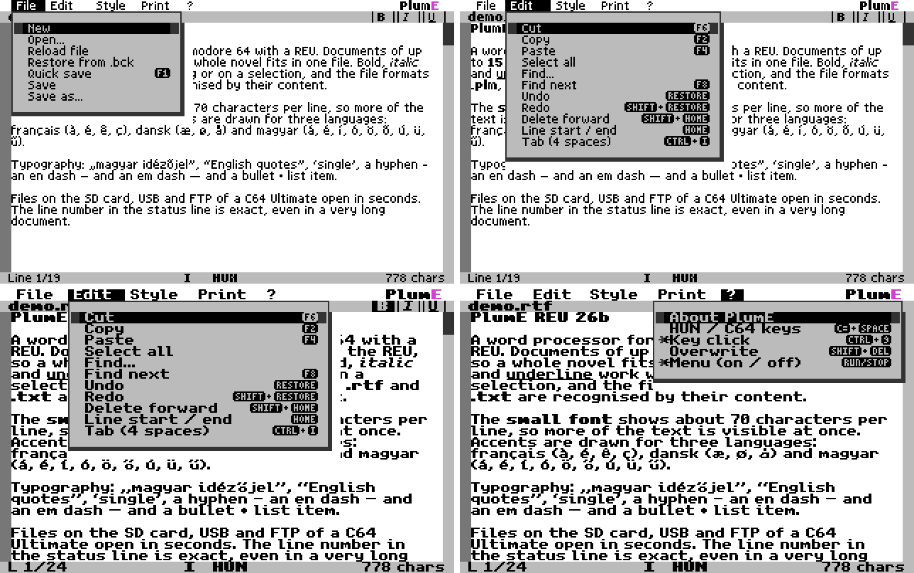

# PlumE REU

**A graphical word processor for the Commodore 64 with a REU: documents of up to about 15 MB, RTF and plain-text files, the SD card and USB of a C64 Ultimate, undo/redo and a quick save.** Mouse or joystick, pull-down menus, bold, italic, underline, accented characters (French, Danish, Hungarian) and printing on a Commodore MPS-803, all on a Magic Desk cartridge that boots straight into the editor.

**PlumE** (the *E* stands for *enhanced*) is an extended fork of [**Plume**](https://github.com/labbej27/plume64) by **LABBEJ27**. Its edition for a C64 with a REU is called **PlumE REU** and is numbered by year and letter: `26a` was the first release of 2026, `26b` the first correction of it and `26c` the third release (text colours and reverse video). PlumE REU is based on Plume 2.2 and is a separate project. The original Plume is small on purpose and runs on an unexpanded C64; PlumE REU needs a REU of at least 256 KB (on a C64 Ultimate: the 16 MB REU enabled). If you have no REU, use the original Plume.

## Features

- **Big documents**: the whole document lives in the REU (up to ~15 MB instead of 20,000 characters) and a sliding window in RAM follows the cursor. PLM3 format above 64 KB.
- **Three file formats, recognised by content**: `.plm` (the native Plume format), `.rtf` (Word, LibreOffice: bold, italic, underline, accents) and `.txt` (UTF-8 or ASCII, any line ending). Save keeps the document's own format; Save as offers PLM, RTF and TXT. Saving as text warns first and removes the formatting from the screen too, so the document is exactly the file.
- **C64 Ultimate file system**: Open, Save, Save as and Quick save work on the SD card, USB, Flash and the mounted FTP servers (`/ftp/`) through the Ultimate's command interface, and are fast (a 250 KB RTF opens in about 12 seconds instead of minutes over the IEC serial bus). IEC drives 8 to 11 (`D 8`..`D 11`) work as before.
- **One file requester** for Open and Save as: *D 8* / *C64U* buttons (the IEC drives 8 to 11 and the Ultimate's file system), folders, sizes in blocks or K/M/G, files that do not fit the REU's real free room are greyed out (not a fixed limit), mouse wheel, a click selects a row (grey) and the *Open* button, Space, Return or a second click opens it, long names shortened in the middle, a pointer that turns into an hourglass while the Ultimate is read, a confirmation before a file is replaced. It works from the keyboard as well: cursor Up / Down, Space or Return, `RUN/STOP` cancels. Folders can be nested without a practical limit (paths up to 255 characters, shown by their end), and names up to 63 characters work (longer names are listed greyed out and cannot be chosen).
- **Binary files are recognised**: opening a file that looks binary (NUL bytes or many control characters) warns that it cannot be shown correctly; if you go on it opens as text without a name, so *Save* always asks for a new name and the original file is never overwritten.
- **Undo / Redo** that goes back to the start of the session (even across saves), with a journal in the REU.
- **Quick save** (`F1`): writes only the changes to `NAME.bck` next to the file; restored automatically when the file is opened. *New* and *Open* ask first when the changes live only in the `.bck`.
- **Selection and clipboard over the whole document** (the clipboard is in the REU, 256 KB): *Select all*, cut, copy, paste and delete work on huge selections.
- **Exact line numbers**: a background index lays the document out while you are idle, so the status line shows `Line N/total` even in a very long document (a `~` marks an estimate until the index is ready). It never slows typing.
- **Small or normal font**: *Style → Small font* (on by default) is a hand-drawn proportional font with one-pixel strokes, about 60 to 72 characters per line instead of about 46. Printing always uses the normal font.
- **Scrollbar** over the whole document, **find** across the whole document, **double click** selects a word, **triple click** a sentence, a mouse wheel, an insert/overwrite mode.
- **Works without the mouse**: `RUN/STOP` opens the menu bar (cursor keys move through the menus and items, `Space` or `Return` choose, `RUN/STOP` closes it) and the menus show their keys as small key caps; `C=` + a cursor key selects text (`C=` + `Shift` + cursor goes up or left); `B` / `I` / `U` change the character under the cursor when nothing is selected.
- **Text colours and reverse video (RVS)**: the eight colours of the number keys on `CTRL` + `1` … `8` (black, white, red, cyan, purple, green, blue, yellow), RVS on `CTRL` + `9` and off `CTRL` + `0` (all of it also in the *Color* menu, with the key caps); every theme keeps the colours visible (white on white is light grey, black on black is dark grey). Saved in PLM and RTF (`\cf`, `\highlight`). The C64 colours are per 8x8 cell, so colouring works best word by word: see *Colours in detail* below.
- **Typographic punctuation**: `„` `”` `“` `‘` `’` `–` `—` `•` on `C=` + `1` … `8` (`Shift` + `C=` + `1` … `8` in the Hungarian layout); the RTF `\endash`, `\emdash`, `\bullet`, `\lquote`, `\rquote`, `\ldblquote`, `\rdblquote` and `\uN` codes are read and written back, the plain `"` and `'` stay on the keyboard as they were.
- **Paragraph alignment**: *Align* menu with Left, Centre, Right and Justify (justified text spreads the spaces; the last line stays left), for the paragraph at the cursor or the whole selection (also *Select all* of a big document). Saved in PLM and RTF (`\qc` `\qr` `\qj`).
- **Fixed width** (*Style → Fixed width*) shows the text in equal-width cells; the menus always use the small font.
- **Four colour themes** (`CTRL` + `←`); on a C64 Ultimate the keyboard and case LEDs follow the theme and the keyboard LED shows unsaved changes.
- **Printing** on a Commodore MPS-803 / MPS-801 (device 4) with 3 cm margins on A4: *Graphics* (exactly what is on screen), *Text* (the printer's characters, faster, without accents) and *Wide text*; large documents are printed in chunks. A progress bar shows how far printing is. On a C64 Ultimate, a document with colours or RVS prints in colour (see *Colour printing*).
- **Four editions** (menus in English, keyboard and letters per language): French, English, Danish, Hungarian.

The full list of changes since Plume 2.2 is in [CHANGES.md](CHANGES.md).

## Screenshots

The small font (the default), about 70 characters per line, and the normal font:

The four colour themes (`CTRL` + `←`), with the small font and with the normal font:

Text colours and reverse video (RVS): the eight colours of the number keys (`CTRL` + `1` … `8`), RVS bars (`CTRL` + `9` / `CTRL` + `0`), and style and colour together. The document is [`docs/colordemo.rtf`](docs/colordemo.rtf), an RTF file with `\cf` and `\highlight` codes (open it to try the colours):

The same document on the four themes (white is light grey on the light theme, every colour stays visible):

The Style menu with *RVS on* / *RVS off* and the colour keys:

On a C64 Ultimate the keyboard and case LEDs follow the colour theme (light, green, blue, yellow):

| | |
|---|---|
|  |  |
|  |  |

The file requester (Open with its *Open* button, Save as with the format buttons), the Find box and the About box, and the File, Edit and Help menus with their key caps (small and normal font):

## Install

1. Copy the cartridge for your edition to your SD card or USB drive: [`dist/plumereu-en-26c.crt`](dist/plumereu-en-26c.crt), [`fr`](dist/plumereu-fr-26c.crt), [`dk`](dist/plumereu-dk-26c.crt) or [`hu`](dist/plumereu-hu-26c.crt) (also attached to the [release](https://github.com/nmakk/plume64/releases)). They are Magic Desk cartridges.
2. On a C64 Ultimate enable the REU (at least 256 KB; 16 MB recommended), then run the `.crt` from the Ultimate's file browser. Files on the SD card, USB and FTP need the Ultimate's command interface (tested with firmware 3.14 on an Ultimate II+L and 1.2.1 on a C64 Ultimate); Plume checks it at start-up. Without it the program still starts, but there is no SD, USB or FTP access (it reports "No C64 Ultimate found.") and everything works on a disk in drive 8. Without a REU the program also starts, but no text can be entered: the document lives in the REU.
3. For disk documents put a disk or a `.d64` / `.d81` in drive 8. [`dist/plume.d64`](dist/plume.d64) is an empty `.d64`.

## Using it

**Keys**: `F1` quick save, `F3`/`F5`/`F7` bold/italic/underline, `F2`/`F4`/`F6` copy/paste/cut, `F8` find next, `CTRL`+`Z` / `CTRL`+`Y` undo/redo, `RUN/STOP` cancels any dialog or, in the editor, opens the menu bar (cursor keys move, `Space` or `Return` choose, `RUN/STOP` closes it again; *? → Menu (on / off)* reminds you). `RESTORE` is undo and `Shift`+`RESTORE` redo. `C=` + a cursor key selects text, `Home` goes to the start or the end of the line, `Shift`+`Home` deletes forward, `CTRL`+`I` is a Tab (four spaces); *Edit* starts with Undo and Redo, and in the Hungarian edition the insert / overwrite switch is in the *Edit* menu. *File → Reload file* and *Restore from .bck* are menu-only. Every function also has a menu entry. Typographic punctuation: `C=`+`1` … `8` (`Shift`+`C=`+`1` … `8` in the Hungarian layout) types `„` `”` `“` `‘` `’` `–` `—` `•` (Hungarian and English quotes, dashes, bullet). Colours: `CTRL`+`1` … `8`; RVS: `CTRL`+`9` on, `CTRL`+`0` off; the key click is in the *? → Key click* menu. Accented letters use `C=` plus a letter (`C=`+`E` gives é, `C=`+`A` gives à, `C=`+`C` gives ç); `C=`+`-` types an underscore.

**Pointer**: a 1351 mouse on port 1 (a USB mouse on the C64 Ultimate; with a wheel if *Mouse Mode* is *Mouse + Wheel*), or a joystick on port 2 or 1 (one pixel per frame for precise aiming, then faster; fire clicks; hold fire while moving to select). Port 2 is better: port 1 shares its wires with the keyboard, so the keyboard is ignored while a port 1 joystick moves.

**Files**: *File → Open…* opens any format; *Save* and *Quick save* keep the document's format and place; *Save as…* opens the requester with the *PLM* / *RTF* / *TXT* buttons (a new document starts with RTF). A name typed without an extension gets the format's extension. The `.bck` files of the quick save are hidden in the requester; a file that has one is marked with a `*` at the left edge of the list (changes that are only quick saved). Clicking *Disk* again steps to the next IEC drive that answers (`D 8`..`D 11`).

### Editions

- **English** and **French** use the C64 keyboard as it is.
- **Danish** (`dk`): `:` `;` `@` type æ ø å, and with `Shift` Æ Ø Å; `Shift` + `.` and `Shift` + `,` give `:` and `;`; `C=` + `@` gives `@`. `<`, `>`, `[` and `]` are not available in this edition. Every edition displays and prints æ ø å Æ Ø Å (the printer's Text mode prints them as a, o, a).
- **Hungarian** (`hu`), created by **mkckOner**, who drew the letters and wrote the keyboard code, starts with the **HUN** keyboard: the Hungarian layout on the C64 keys (letters stay QWERTY). **`C=` + `Space`** (or *? → HUN / C64 keys*) switches to the **C64** keyboard (the `C=` layer) and back; the status line shows `HUN` or `C64`.

| Key (C64 legend) | Plain | `Shift` |
|---|---|---|
| `←` | 0 | ? |
| `1` … `9` | 1 … 9 | `'` `"` `+` `!` `%` `/` `=` `(` `)` |
| `0` (Ö) | ö | Ö |
| `+` (Ü) | ü | Ü |
| `-` (Ó) | ó | Ó |
| `↑` (Í) | í | Í |
| `@` (Ő) | ő | Ő |
| `*` (Ú) | ú | Ú |
| `:` (É) | é | É |
| `;` (Á) | á | Á |
| `=` (Ű) | ű | Ű |
| `£` | `€` | `-` |
| `,` `.` `/` | `,` `.` `/` | `<` `>` `?` |
| `CLR/HOME` | start of line; already there: end of line | delete forward (repeats like `INST/DEL`) |
| `INST/DEL` | delete backwards | toggle insert / overwrite |

Under `C=` each key gives its original C64 symbol: `C=` + `1` … `9` gives `!` `"` `#` `$` `%` `&` `'` `(` `)`, `C=` + `Ü` `Ó` `Ű` gives `+` `-` `=`, `C=` + `Ö` gives `0`, `C=` + `↑` gives `^`, `C=` + `£` gives `€`, `C=` + `←` gives `←`, `C=` + `É` `Á` `Ú` `Ő` gives `:` `;` `*` `@`. `C=` + `Shift` + `É` / `Á` gives `[` / `]`, and `C=` + `Shift` + `-` gives `_`. `CTRL` stays where it is, `RUN/STOP` is Esc. `Shift` + `CLR/HOME` deletes forward on the C64 keyboard too. The Tab (four spaces) is `CTRL`+`I`, also in the Edit menu.

## Colours in detail

The screen is a hires bitmap in which each 8x8-pixel cell has one ink colour, and PlumE's text is proportional, so two letters of different colours can fall into the same cell. PlumE makes the best of it:

- **Whole words are always right.** When a word of another colour follows a space and would share a cell with the end of the previous word, the space grows to the next cell edge (0 to 7 pixels, usually 1 or 2, and only where the colours differ). It is still a single space in the text; printing does not stretch it.
- **Punctuation** (`. , ; : ! ? ' " ) -`) right after a word takes the word's colour.
- **Inside a word** the colours can bleed: if the colour changes in the middle of a word, or letters are coloured one by one, neighbouring letters share cells and the letter covering most of the cell wins it (the later one if equal): a coloured letter never disappears, but it tints its neighbours. This is the hardware's limit, not a bug.
- **RVS** (reverse video) fills the cells with the colour and draws the letters in the paper colour; the bar is continuous over a phrase and ends where the last letter ends. Inside RVS only bold is kept (no italic or underline). If a selection contains RVS text, the RVS part blinks (so you can tell it from a plain RVS word) and the rest stays selected.
A close-up of the rules (the space before *Thank you,* grew to the next cell edge, the comma and the `!` took their word's colour, and the single coloured letters of *colourful* bleed into each other):

- **Each theme has its own colour table** so every colour stays visible; the default colour is the theme's text colour. *Style → Plain* removes style, colour and RVS.
- **Colour printing** (C64 Ultimate): if the document has colours or RVS, *Print → Graphics* and *Text* print in colour on the Ultimate's virtual printer. PlumE sets the printer to *PNG COLOR* itself (graphics also use the *Epson FX-80* emulation) and puts it back to *PNG B&W* / *Commodore MPS* before the next plain print. Colours go to the printer's inks (red = orange, purple = magenta, blue = violet, white prints nothing), RVS is a bar with the letters cut out. Graphics keep the font. Then flush the page in the Ultimate's printer menu. A real printer never gets these codes.
- **Files**: PLM and RTF keep the colours (RTF: `\colortbl`, `\cfN`, `\highlightN` for RVS; other colours of an imported RTF become the nearest of the eight). Older versions cannot show a PLM file that uses colours correctly.

## Good to know

- **FTP folders (`/ftp/...`) on a C64 Ultimate**: the Ultimate caches every file it reads from an FTP server and never refreshes the copy. PlumE removes the cached copy before it opens a file, so you always get the current file; if the file image is still incomplete it says so (*Incomplete read: stale FTP cache?*) instead of loading garbage.

- **Disk access**: Plume hides the sprites during IEC disk access, otherwise JiffyDOS falls back to slow serial transfer. Do not read the C64 Ultimate's memory over the REST API during disk access.
- **RTF code pages**: `\ansicpg1250` (Hungarian ő ű as `\'f5` `\'fb`) and the usual cp1252 escapes are read correctly. Not handled: other code pages and RTF text colours. Loading a very large file over IEC is very slow; use the C64U buttons.
- **Styling a selection**: *Bold* / *Italic* / *Underline* / *Plain* work on a selection that fits into the editing window in RAM (about 2500 characters); for a larger one Plume says so and the style can be applied in parts. Copy, cut, paste, delete and find work on any size. Long runs of one style are no problem for editing or saving.
- **Original Plume files**: PLM1 and PLM2 documents of the original Plume open directly; PLM3 (over 64 KB) cannot be read by the original.
- From a Mac, [`tools/c64u/Loadfromc64u.sh`](tools/c64u/Loadfromc64u.sh) and [`Savetoc64u.sh`](tools/c64u/Savetoc64u.sh) fetch and store files in a disk image on a C64 Ultimate (FTP + `c1541`).

## Quick save in detail

**Why it exists.** Saving a whole document means writing every byte of it again. For a large document that takes long: over the IEC serial bus of a plain C64 a 250 KB file needs minutes, and even on the C64 Ultimate or a disk image the time grows with the size of the document, although only a few words may have changed. Quick save (`F1`) writes only what changed, so it takes a moment whatever the size of the document, and the original file stays untouched until the next full *Save*.

**How it works.**
1. **The journal.** Every edit is recorded in the REU as it happens: a 7-byte header (position, number of deleted bytes, number of inserted bytes) followed by the inserted text. Letters typed one after another and repeated backspaces extend the last record instead of making new ones. The deleted text is kept in a second REU area; the same journal drives Undo and Redo.
2. **F1 writes `NAME.bck` next to the file** (same drive, SD card or USB; on a disk the name is at most 12 characters plus `.bck`). The file starts with a 13-byte header: `PBK3`, the length of the file it belongs to, a 16-bit signature of that file (its length and three samples of 128 bytes: start, middle and end) and the length of the journal. Then comes the journal since the last full save. If nothing has changed since then, `F1` only removes an old `.bck` and marks the document as saved.
3. **Opening the file** looks for `NAME.bck`. If its length and signature match the file, the edits are replayed silently and *Quick save restored.* is shown; everything is back as you left it, and Undo works across the restored edits. If they do not match (the file was changed by another program or replaced), Plume asks whether to apply the `.bck` anyway; nothing is ever applied or thrown away without asking.
4. **Leaving the document** (*New* or *Open*) after a quick save asks `Only quick saved (.bck). Save the whole file now?`: *Save* writes the whole file first, *No save* goes on and the changes stay in the `.bck`.
5. **A full *Save* or *Save as*** writes the whole file, makes it the new base of the journal and deletes the `.bck`.
6. **Two ways to get the plain file**: *File → Reload file* opens the file without its `.bck`; *File → Restore from .bck* opens it with the `.bck`.

**Good to know.**
- The `.bck` is only valid for the file it was made for. When you copy a document to another place, copy the `.bck` with it, or do a full *Save* first.
- The journal holds about 256 KB of edits and 40,000 records (16 KB and 2,500 on a REU under 2 MB). When it is full, `F1` does a full save instead and starts a new journal.
- The `.bck` files are hidden in the file requester, so they cannot be opened by mistake; a `*` at the left of a file name tells that it has a `.bck` (on the SD card by trying to open `NAME.bck`, on a disk by a filtered directory read of `$0:NAME.BCK`).
- On a C64 Ultimate the keyboard LED lights while there are unsaved changes and goes out after `F1` or *Save*.

## Tested on

A Commodore 64 Ultimate (firmware 1.2.1) with a 16 MB REU, at 1 MHz and 64 MHz, with a real MPS-803; and on a real Commodore 64 with an Ultimate II+L cartridge (firmware 3.14) and a REU. The French, Danish and English editions have had less hardware testing than the Hungarian one; feedback is welcome.

## Building

`make`, `python3`, [cc65](https://github.com/cc65/cc65) and [VICE](https://vice-emu.sourceforge.io) (for `c1541`) are needed (`brew install cc65 vice` on macOS). Then run `make`: it builds `build/plumereu-fr-26c.crt`, `plumereu-en-26c.crt`, `plumereu-dk-26c.crt` and `plumereu-hu-26c.crt`. The original-edition cartridges (`build/plume-XX.crt`, for an unexpanded C64) are no longer part of the default target; build them with `make build/plume-en.crt` etc. They are kept for reference and are not developed further here.

## How it is made

- **Language**: C (cc65) for the logic, 6502 assembly for glyph drawing, line layout and scrolling.
- **Memory**: the graphics screen is hidden under the ROMs; the program code is split into *overlays* kept in cartridge banks (`plume-reu.cfg`, `ovl_load` in `src/reu.s`) and copied into a shared RAM area when needed. The fonts (banks 59 and 60), the LED code (bank 62) and the SD/USB module (bank 61, `src/sd.s`) also live in cartridge banks.
- **Styles**: small invisible markers in the text, only where the style changes.
- **Fonts**: the normal font is [unscii](http://viznut.fi/unscii/) by viznut (public domain), made proportional with redrawn accents (`tools/mkfont.py`); the small font is hand-drawn for this project (`tools/mkfont_small.py`).

## Credits and licence

- **Plume**: LABBEJ27 — <https://github.com/labbej27/plume64> (the online editor at [labbej.eu/plume](https://labbej.eu/plume) writes `.d64` disks Plume opens).
- **PlumE REU**: Norbert Makk.
- **Hungarian edition and keyboard**: mkckOner.
- **unscii font**: viznut (public domain).

[MIT](LICENSE); the copyright of Plume (LABBEJ27) and of the PlumE additions (Norbert Makk) is kept. Third-party components: [NOTICE](NOTICE). The cc65 runtime library linked into the program is under the zlib licence.
