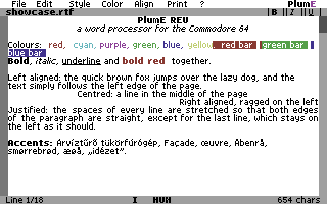
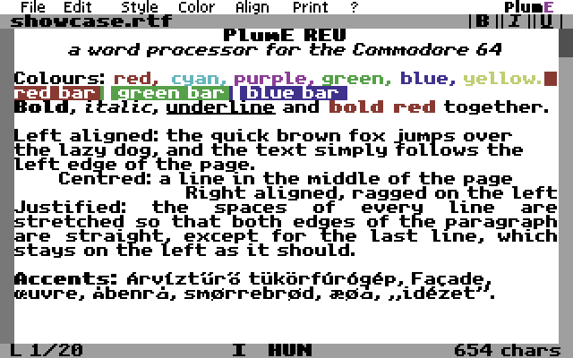
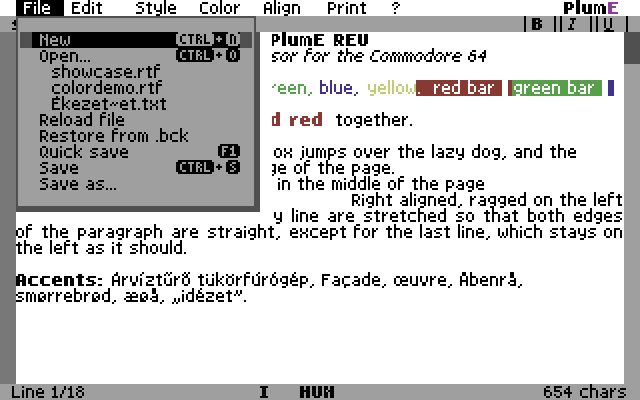
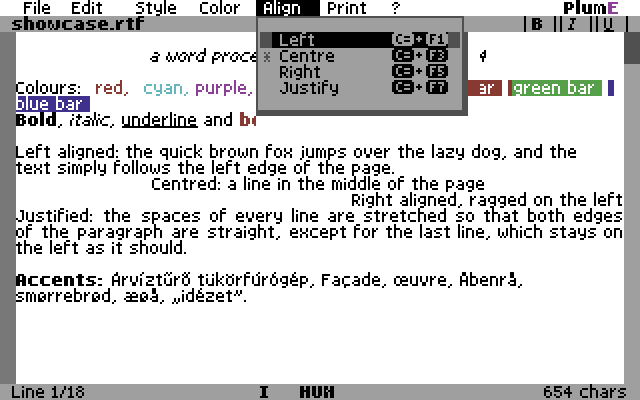
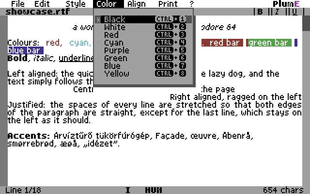
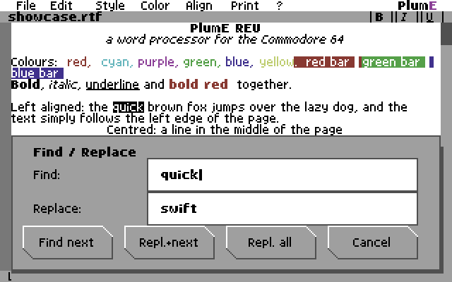
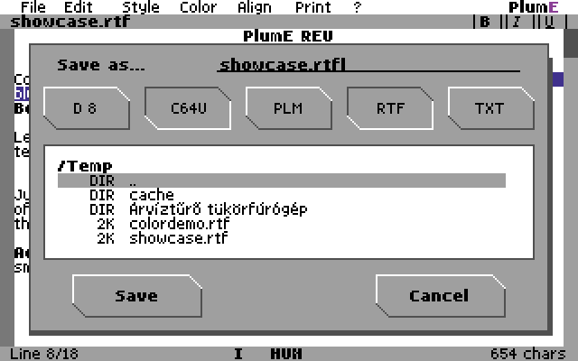
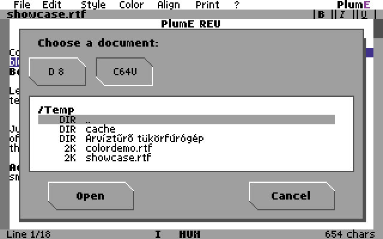
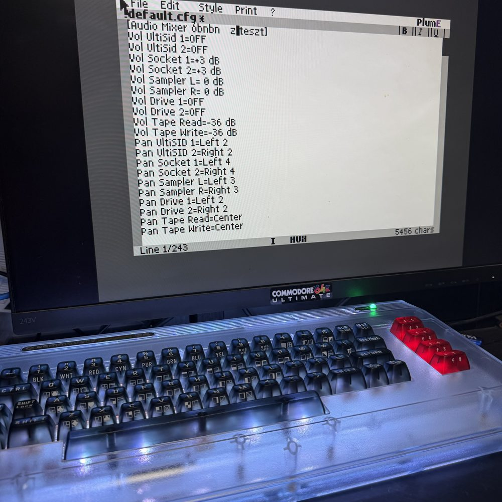
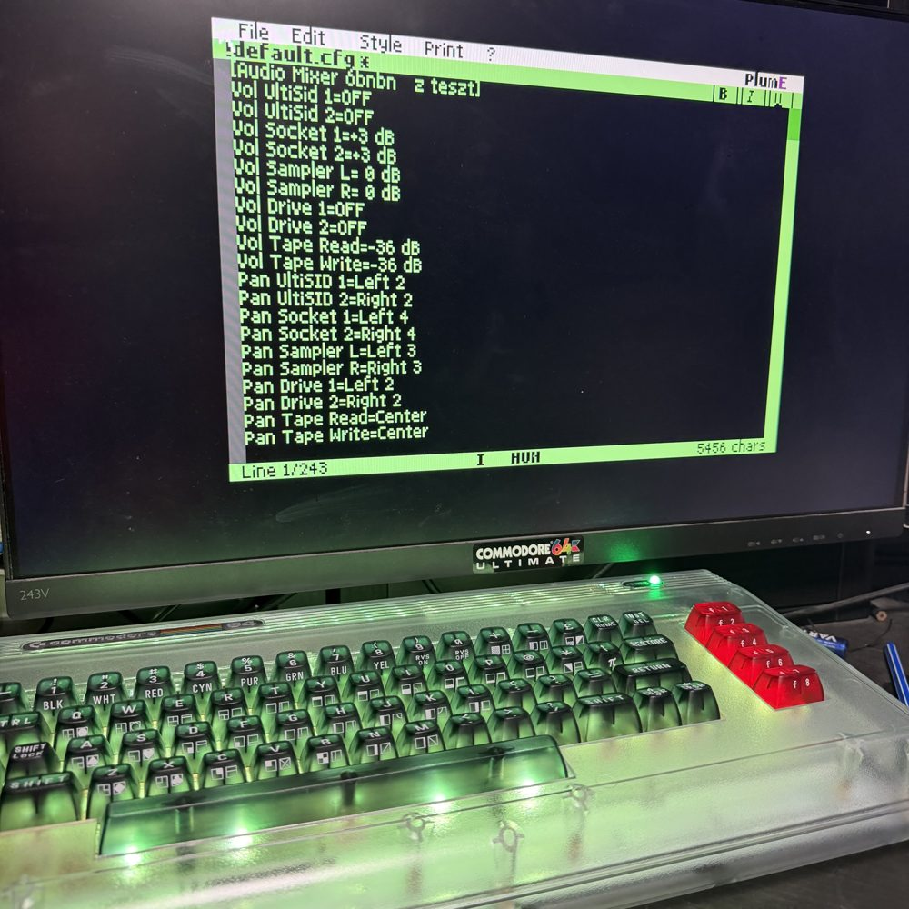

# PlumE REU

**A graphical word processor for the Commodore 64 with a REU.** Documents of up to about 15 MB, RTF and plain-text files, the SD card, USB and FTP of a C64 Ultimate, paragraph alignment, colours, find and replace, recent files, undo/redo and a quick save. Mouse or joystick, pull-down menus, accented characters (French, Danish, Hungarian) and printing on a Commodore MPS-803 (in colour on an Ultimate), all on a Magic Desk cartridge that boots straight into the editor.

**PlumE** (the *E* stands for *enhanced*) is an extended fork of [**Plume**](https://github.com/labbej27/plume64) by **LABBEJ27**. The edition for a C64 with a REU is called **PlumE REU** and is numbered by year and letter (`26a` … `26d`). It needs a REU of at least 256 KB (on a C64 Ultimate: the 16 MB REU enabled); without a REU use the original Plume.

## Features

- **Big documents**: the whole document lives in the REU (up to ~15 MB); a sliding window in RAM follows the cursor. Exact line numbers, a scrollbar and search over the whole document.
- **Three file formats, recognised by content**: `.plm` (the native format), `.rtf` (Word, LibreOffice: bold, italic, underline, colours, alignment, accents) and `.txt` (UTF-8). *Save as* has *PLM / RTF / TXT* buttons and a name field.
- **C64 Ultimate file system**: SD card, USB, Flash and mounted FTP servers through the command interface; accented (UTF-8) file names; the last five files in the *File* menu.
- **Text formatting**: bold, italic, underline, eight text colours and reverse video, paragraph alignment (left, centre, right, justify), fixed width, a small proportional font and the normal font, four colour themes.
- **Find and replace** (`CTRL`+`F`) with a real line editor; *Replace all* with a progress bar.
- **Undo / Redo** back to the start of the session, and a **quick save** (`F1`) that writes only the changes to a `.bck` file next to the document.
- **Works without the mouse**: menu keys, quick keys (`CTRL`+`N` `O` `S` `F` `A` `P` `C` `X` `V`), joystick pointer.
- **Printing** on an MPS-803 / MPS-801: graphics, text and wide text; colour on an Ultimate's virtual printer.
- **Four editions**: French, English, Danish and Hungarian keyboards and letters.

The long story is in [docs/DETAILS.md](docs/DETAILS.md) (keyboards, colours, quick save, good to know) and the history in [CHANGES.md](CHANGES.md).

## Screenshots

The small font (default) shows about 70 characters per line, the normal font fewer; every text colour stays visible on the four themes:

Menus with their key caps, recent files under *Open*, and the Align menu:

| | |
|---|---|
|  |  |
|  |  |
|  |  |

On a C64 Ultimate the keyboard and case LEDs follow the colour theme and the keyboard LED shows unsaved changes:

| | |
|---|---|
|  |  |
|  |  |

Try the documents [`docs/showcase.rtf`](docs/showcase.rtf) and [`docs/colordemo.rtf`](docs/colordemo.rtf).

## Install

1. Copy the cartridge for your edition to your SD card or USB drive: [`dist/plumereu-en-26d.crt`](dist/plumereu-en-26d.crt), [`fr`](dist/plumereu-fr-26d.crt), [`dk`](dist/plumereu-dk-26d.crt) or [`hu`](dist/plumereu-hu-26d.crt) (also attached to the [release](https://github.com/nmakk/plume64/releases)). They are Magic Desk cartridges.
2. On a C64 Ultimate enable the REU (at least 256 KB; 16 MB recommended), then run the `.crt` from the Ultimate's file browser. Files on the SD card, USB and FTP need the Ultimate's command interface (tested with firmware 3.14 on an Ultimate II+L and 1.2.1 on a C64 Ultimate); Plume checks it at start-up. Without it the program still starts, but there is no SD, USB or FTP access (it reports "No C64 Ultimate found.") and everything works on a disk in drive 8. Without a REU the program also starts, but no text can be entered: the document lives in the REU.
3. For disk documents put a disk or a `.d64` / `.d81` in drive 8. [`dist/plume.d64`](dist/plume.d64) is an empty `.d64`.

## Using it

**Keys**: `F1` quick save, `F3` `F5` `F7` bold / italic / underline, `F2` `F4` `F6` or `CTRL`+`C` `V` `X` copy / paste / cut, `F8` find next, `CTRL`+`F` find and replace, `CTRL`+`Z` / `CTRL`+`Y` undo / redo, `CTRL`+`1` … `8` colours, `CTRL`+`9` / `0` RVS on / off, `C=`+`F1` `F3` `F5` `F7` align, `CTRL`+`←` colour theme. `RUN/STOP` cancels a dialog or opens the menu bar (cursor keys move, `Return` chooses). Every function is also in a menu, with its key shown as a key cap.

**Files**: *File → Open…* opens any format (a double click on a file or folder; `Tab` enters a folder from the keyboard). *Save* and *Quick save* keep the document's format and place. *Save as…* has a name field and the *PLM / RTF / TXT* buttons; the buttons win over a known extension (`abc.txt` with *RTF* pressed becomes `abc.rtf`), other extensions such as `.cfg` are kept. The recent files are in the *File* menu (C64 Ultimate only, kept in `/Flash/config/plume.cfg`).

**Pointer**: a 1351 mouse on port 1 (a USB mouse on the C64 Ultimate), or a joystick on port 2 or 1.

**Screen palettes** for the Ultimate (VICE `.vpl`): [`docs/palettes/`](docs/palettes) (`plume-pepto.vpl`, `plume-windows.vpl`).

### Editions

- **English** and **French** use the C64 keyboard as it is; **Danish** types æ ø å on `:` `;` `@`.
- **Hungarian** (`hu`), created by **mkckOner**, starts with the **HUN** keyboard (the key table is in [DETAILS](docs/DETAILS.md#editions)); `C=` + `Space` switches to the original C64 keyboard.

## Tested on

A Commodore 64 Ultimate (firmware 1.2.1) with a 16 MB REU, at 1 MHz and 64 MHz, with a real MPS-803; and on a real Commodore 64 with an Ultimate II+L cartridge (firmware 3.14) and a REU. The French, Danish and English editions have had less hardware testing than the Hungarian one; feedback is welcome.

## Building

`make`, `python3`, [cc65](https://github.com/cc65/cc65) and [VICE](https://vice-emu.sourceforge.io) (for `c1541`) are needed (`brew install cc65 vice` on macOS). Then run `make`: it builds `build/plumereu-fr-26d.crt`, `plumereu-en-26d.crt`, `plumereu-dk-26d.crt` and `plumereu-hu-26d.crt`. The original-edition cartridges (`build/plume-XX.crt`, for an unexpanded C64) are no longer part of the default target; build them with `make build/plume-en.crt` etc. They are kept for reference and are not developed further here.

## How it is made

- **Language**: C (cc65) for the logic, 6502 assembly for glyph drawing, line layout and scrolling.
- **Memory**: the graphics screen is hidden under the ROMs; the program code is split into *overlays* kept in cartridge banks (`plume-reu.cfg`, `ovl_load` in `src/reu.s`) and copied into a shared RAM area when needed. The fonts (banks 59 and 60), the LED code (bank 62) and the SD/USB module (bank 61, `src/sd.s`) also live in cartridge banks.
- **Styles**: small invisible markers in the text, only where the style changes.
- **Fonts**: the normal font is [unscii](http://viznut.fi/unscii/) by viznut (public domain), made proportional with redrawn accents (`tools/mkfont.py`); the small font is hand-drawn for this project (`tools/mkfont_small.py`).

## Credits and licence

- **Plume**: LABBEJ27 — <https://github.com/labbej27/plume64> (the online editor at [labbej.eu/plume](https://labbej.eu/plume) writes `.d64` disks Plume opens).
- **PlumE REU**: Norbert Makk.
- **Hungarian edition and keyboard**: mkckOner.
- **unscii font**: viznut (public domain).

[MIT](LICENSE); the copyright of Plume (LABBEJ27) and of the PlumE additions (Norbert Makk) is kept. Third-party components: [NOTICE](NOTICE). The cc65 runtime library linked into the program is under the zlib licence.
