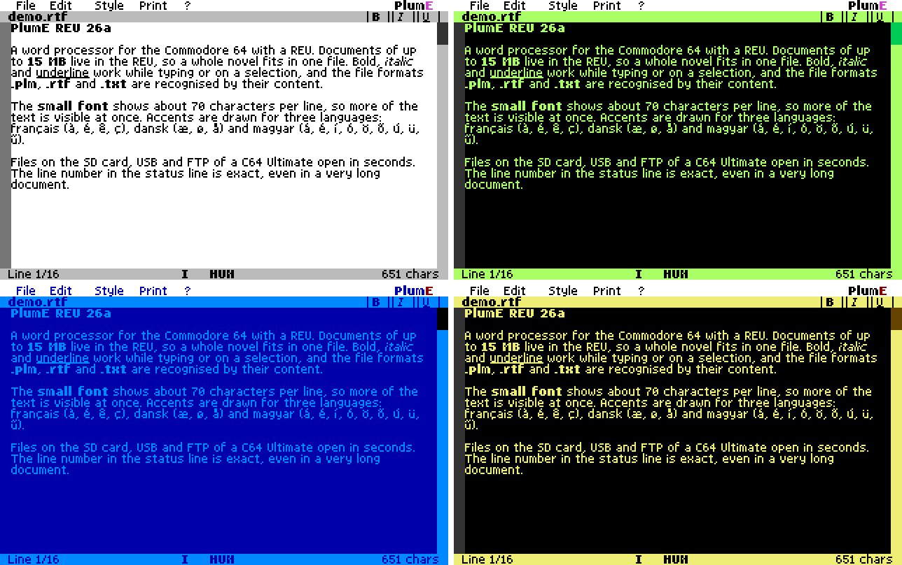
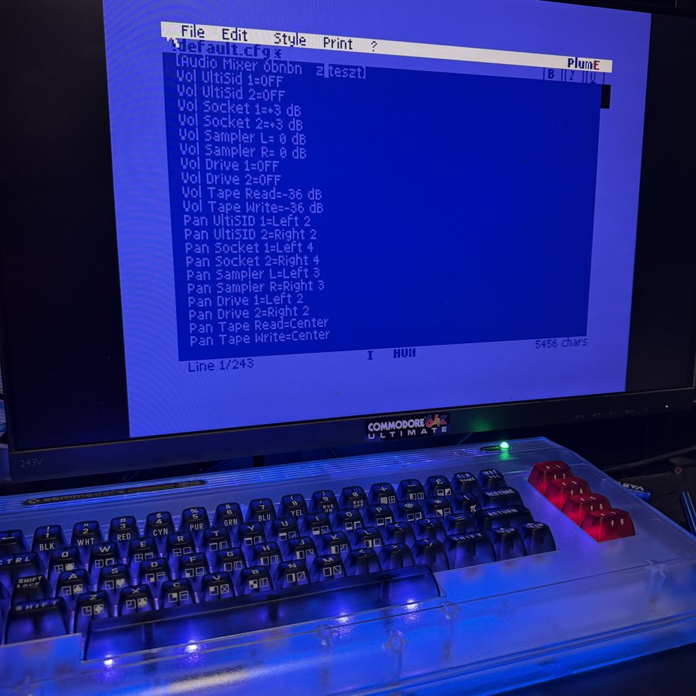
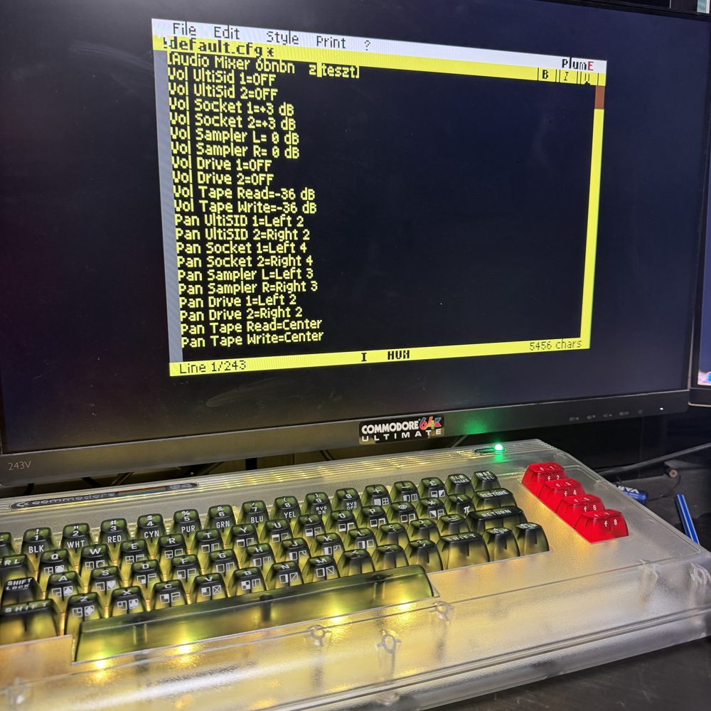
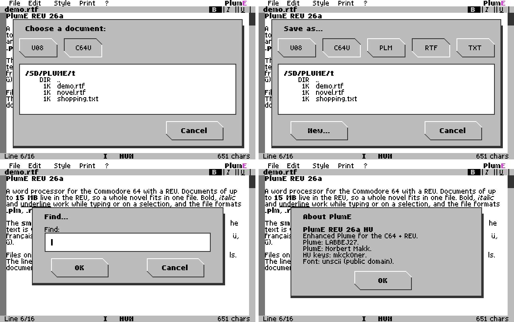

# PlumE REU

**A graphical word processor for the Commodore 64 with a REU: documents of up to about 15 MB, RTF and plain-text files, the SD card and USB of a C64 Ultimate, undo/redo and a quick save.** Mouse or joystick, pull-down menus, bold, italic, underline, accented characters (French, Danish, Hungarian) and printing on a Commodore MPS-803, all on a Magic Desk cartridge that boots straight into the editor.

**PlumE** (the *E* stands for *enhanced*) is an extended fork of [**Plume**](https://github.com/labbej27/plume64) by **LABBEJ27**. Its edition for a C64 with a REU is called **PlumE REU** and is numbered by year and letter: `26a` is the first release of 2026. PlumE REU is based on Plume 2.2 and is a separate project. The original Plume is small on purpose and runs on an unexpanded C64; PlumE REU needs a REU of at least 256 KB (on a C64 Ultimate: the 16 MB REU enabled). If you have no REU, use the original Plume.

## Features

- **Big documents**: the whole document lives in the REU (up to ~15 MB instead of 20,000 characters) and a sliding window in RAM follows the cursor. PLM3 format above 64 KB.
- **Three file formats, recognised by content**: `.plm` (the native Plume format), `.rtf` (Word, LibreOffice: bold, italic, underline, accents) and `.txt` (UTF-8 or ASCII, any line ending). Save keeps the document's own format; Save as offers PLM, RTF and TXT. Saving as text warns first and removes the formatting from the screen too, so the document is exactly the file.
- **C64 Ultimate file system**: Open, Save, Save as and Quick save work on the SD card, USB, Flash and the mounted FTP servers (`/ftp/`) through the Ultimate's command interface, and are fast (a 250 KB RTF opens in about 12 seconds instead of minutes over the IEC serial bus). IEC drives 8 to 11 (`U08`..`U11`) work as before.
- **One file requester** for Open and Save as: *Disk* / *C64U* buttons, folders, sizes in blocks or K/M/G, mouse wheel, long names shortened in the middle, a pointer that turns into an hourglass while the Ultimate is read, a confirmation before a file is replaced. Folders can be nested without a practical limit (paths up to 255 characters, shown by their end), and names up to 63 characters work (longer names are listed greyed out and cannot be chosen).
- **Binary files are recognised**: opening a file that looks binary (NUL bytes or many control characters) warns that it cannot be shown correctly; if you go on it opens as text without a name, so *Save* always asks for a new name and the original file is never overwritten.
- **Undo / Redo** that goes back to the start of the session (even across saves), with a journal in the REU.
- **Quick save** (`F1`): writes only the changes to `NAME.bck` next to the file; restored automatically when the file is opened.
- **Selection and clipboard over the whole document** (the clipboard is in the REU, 256 KB): *Select all*, cut, copy, paste and delete work on huge selections.
- **Exact line numbers**: a background index lays the document out while you are idle, so the status line shows `Line N/total` even in a very long document (a `~` marks an estimate until the index is ready). It never slows typing.
- **Small or normal font**: *Style → Small font* (on by default) is a hand-drawn proportional font with one-pixel strokes, about 60 to 72 characters per line instead of about 46. Printing always uses the normal font.
- **Scrollbar** over the whole document, **find** across the whole document, **double click** selects a word, **triple click** a sentence, a mouse wheel, an insert/overwrite mode.
- **Four colour themes** (`CTRL` + `←`); on a C64 Ultimate the keyboard and case LEDs follow the theme and the keyboard LED shows unsaved changes.
- **Printing** on a Commodore MPS-803 / MPS-801 (device 4) with 3 cm margins on A4: *Graphics* (exactly what is on screen), *Text* (the printer's characters, faster, without accents) and *Wide text*; large documents are printed in chunks.
- **Four editions** (menus in English, keyboard and letters per language): French, English, Danish, Hungarian.

The full list of changes since Plume 2.2 is in [CHANGES.md](CHANGES.md).

## Screenshots

The small font (the default), about 70 characters per line, and the normal font:

The four colour themes (`CTRL` + `←`), with the small font and with the normal font:

On a C64 Ultimate the keyboard and case LEDs follow the colour theme (light, green, blue, yellow):

| | |
|---|---|
|  |  |
|  |  |

The file requester (Open, Save as with the format buttons), the Find box and the About box, and the File and Style menus (small and normal font):

## Install

1. Copy the cartridge for your edition to your SD card or USB drive: [`dist/plumereu-en-26a.crt`](dist/plumereu-en-26a.crt), [`fr`](dist/plumereu-fr-26a.crt), [`dk`](dist/plumereu-dk-26a.crt) or [`hu`](dist/plumereu-hu-26a.crt) (also attached to the [release](https://github.com/nmakk/plume64/releases)). They are Magic Desk cartridges.
2. On a C64 Ultimate enable the REU (at least 256 KB; 16 MB recommended), then run the `.crt` from the Ultimate's file browser. Files on the SD card, USB and FTP need the Ultimate's command interface (tested with firmware 3.14 on an Ultimate II+L and 1.2.1 on a C64 Ultimate); Plume checks it at start-up. Without it the program still starts, but there is no SD, USB or FTP access (it reports "No C64 Ultimate found.") and everything works on a disk in drive 8. Without a REU the program also starts, but no text can be entered: the document lives in the REU.
3. For disk documents put a disk or a `.d64` / `.d81` in drive 8. [`dist/plume.d64`](dist/plume.d64) is an empty `.d64`.

## Using it

**Keys**: `F1` quick save, `F3`/`F5`/`F7` bold/italic/underline, `F2`/`F4`/`F6` copy/paste/cut, `F8` find next, `CTRL`+`Z` / `CTRL`+`Y` undo/redo, `CTRL`+`9` key click on/off, `RUN/STOP` cancels any dialog. `RUN/STOP`+`RESTORE` reloads the file from disk without its `.bck`; `Shift`+`RUN/STOP`+`RESTORE` reloads it with its `.bck`. Every function also has a menu entry. Accented letters use `C=` plus a letter (`C=`+`E` gives é, `C=`+`A` gives à, `C=`+`C` gives ç); `C=`+`-` types an underscore.

**Pointer**: a 1351 mouse on port 1 (a USB mouse on the C64 Ultimate; with a wheel if *Mouse Mode* is *Mouse + Wheel*), or a joystick on port 2 or 1 (one pixel per frame for precise aiming, then faster; fire clicks; hold fire while moving to select). Port 2 is better: port 1 shares its wires with the keyboard, so the keyboard is ignored while a port 1 joystick moves.

**Files**: *File → Open…* opens any format; *Save* and *Quick save* keep the document's format and place; *Save as…* opens the requester with the *PLM* / *RTF* / *TXT* buttons (a new document starts with RTF). A name typed without an extension gets the format's extension. The `.bck` files of the quick save are hidden in the requester. Clicking *Disk* again steps to the next IEC drive that answers (`U08`..`U11`).

### Editions

- **English** and **French** use the C64 keyboard as it is.
- **Danish** (`dk`): `:` `;` `@` type æ ø å, and with `Shift` Æ Ø Å; `Shift` + `.` and `Shift` + `,` give `:` and `;`; `C=` + `@` gives `@`. `<`, `>`, `[` and `]` are not available in this edition. Every edition displays and prints æ ø å Æ Ø Å (the printer's Text mode prints them as a, o, a).
- **Hungarian** (`hu`), created by **mkckOner**, who drew the letters and wrote the keyboard code, starts with the **HUN** keyboard: the Hungarian layout on the C64 keys (letters stay QWERTY). **`C=` + `Space`** (or *? → HUN / C64 keys*) switches to the **C64** keyboard (the `C=` layer) and back; the status line shows `HUN` or `C64`.

| Key (C64 legend) | Plain | `Shift` |
|---|---|---|
| `←` | 0 | ? |
| `1` … `9` | 1 … 9 | `'` `"` `+` `!` `%` `/` `=` `(` `)` |
| `0` (Ö) | ö | Ö |
| `+` (Ü) | ü | Ü |
| `-` (Ó) | ó | Ó |
| `↑` (Í) | í | Í |
| `@` (Ő) | ő | Ő |
| `*` (Ú) | ú | Ú |
| `:` (É) | é | É |
| `;` (Á) | á | Á |
| `=` (Ű) | ű | Ű |
| `£` | Tab (4 spaces) | `-` |
| `,` `.` `/` | `,` `.` `/` | `<` `>` `?` |
| `CLR/HOME` | start of line; already there: end of line | delete forward (repeats like `INST/DEL`) |
| `INST/DEL` | delete backwards | toggle insert / overwrite |

Under `C=` each key gives its original C64 symbol: `C=` + `1` … `9` gives `!` `"` `#` `$` `%` `&` `'` `(` `)`, `C=` + `Ü` `Ó` `Ű` gives `+` `-` `=`, `C=` + `Ö` gives `0`, `C=` + `↑` gives `^`, `C=` + `£` gives `£`, `C=` + `←` gives `←`, `C=` + `É` `Á` `Ú` `Ő` gives `:` `;` `*` `@`. `C=` + `Shift` + `É` / `Á` gives `[` / `]`, and `C=` + `Shift` + `-` gives `_`. `CTRL` stays where it is, `RUN/STOP` is Esc. `Shift` + `CLR/HOME` deletes forward on the C64 keyboard too.

## Good to know

- **Disk access**: Plume hides the sprites during IEC disk access, otherwise JiffyDOS falls back to slow serial transfer. Do not read the C64 Ultimate's memory over the REST API during disk access.
- **RTF code pages**: `\ansicpg1250` (Hungarian ő ű as `\'f5` `\'fb`) and the usual cp1252 escapes are read correctly. Not handled: other code pages and RTF text colours. Loading a very large file over IEC is very slow; use the C64U buttons.
- **Original Plume files**: PLM1 and PLM2 documents of the original Plume open directly; PLM3 (over 64 KB) cannot be read by the original.
- From a Mac, [`tools/c64u/Loadfromc64u.sh`](tools/c64u/Loadfromc64u.sh) and [`Savetoc64u.sh`](tools/c64u/Savetoc64u.sh) fetch and store files in a disk image on a C64 Ultimate (FTP + `c1541`).

## Tested on

A Commodore 64 Ultimate (firmware 1.2.1) with a 16 MB REU, at 1 MHz and 64 MHz, with a real MPS-803; and on a real Commodore 64 with an Ultimate II+L cartridge (firmware 3.14) and a REU. The French, Danish and English editions have had less hardware testing than the Hungarian one; feedback is welcome.

## Building

`make`, `python3`, [cc65](https://github.com/cc65/cc65) and [VICE](https://vice-emu.sourceforge.io) (for `c1541`) are needed (`brew install cc65 vice` on macOS). Then run `make`: it builds `build/plumereu-fr-26a.crt`, `plumereu-en-26a.crt`, `plumereu-dk-26a.crt` and `plumereu-hu-26a.crt`. The original-edition cartridges (`build/plume-XX.crt`, for an unexpanded C64) are no longer part of the default target; build them with `make build/plume-en.crt` etc. They are kept for reference and are not developed further here.

## How it is made

- **Language**: C (cc65) for the logic, 6502 assembly for glyph drawing, line layout and scrolling.
- **Memory**: the graphics screen is hidden under the ROMs; the program code is split into *overlays* kept in cartridge banks (`plume-reu.cfg`, `ovl_load` in `src/reu.s`) and copied into a shared RAM area when needed. The fonts (banks 59 and 60), the LED code (bank 62) and the SD/USB module (bank 61, `src/sd.s`) also live in cartridge banks.
- **Styles**: small invisible markers in the text, only where the style changes.
- **Fonts**: the normal font is [unscii](http://viznut.fi/unscii/) by viznut (public domain), made proportional with redrawn accents (`tools/mkfont.py`); the small font is hand-drawn for this project (`tools/mkfont_small.py`).

## Credits and licence

- **Plume**: LABBEJ27 — <https://github.com/labbej27/plume64> (the online editor at [labbej.eu/plume](https://labbej.eu/plume) writes `.d64` disks Plume opens).
- **PlumE REU**: Norbert Makk.
- **Hungarian edition and keyboard**: mkckOner.
- **unscii font**: viznut (public domain).

[MIT](LICENSE); the copyright of Plume (LABBEJ27) and of the PlumE additions (Norbert Makk) is kept. Third-party components: [NOTICE](NOTICE). The cc65 runtime library linked into the program is under the zlib licence.
